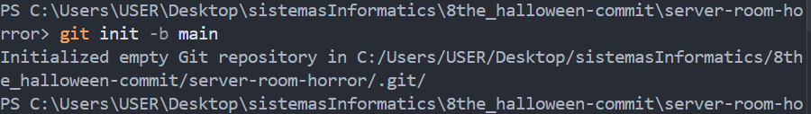
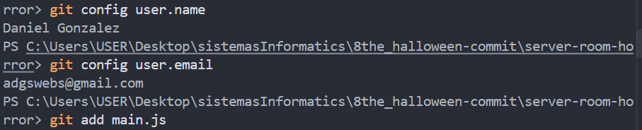
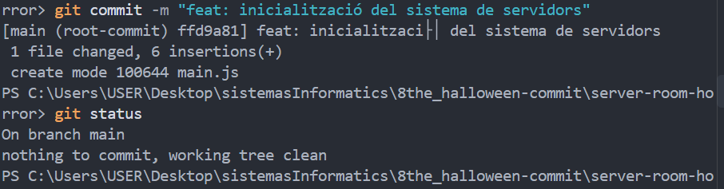
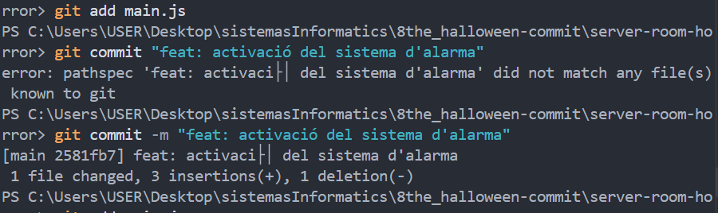
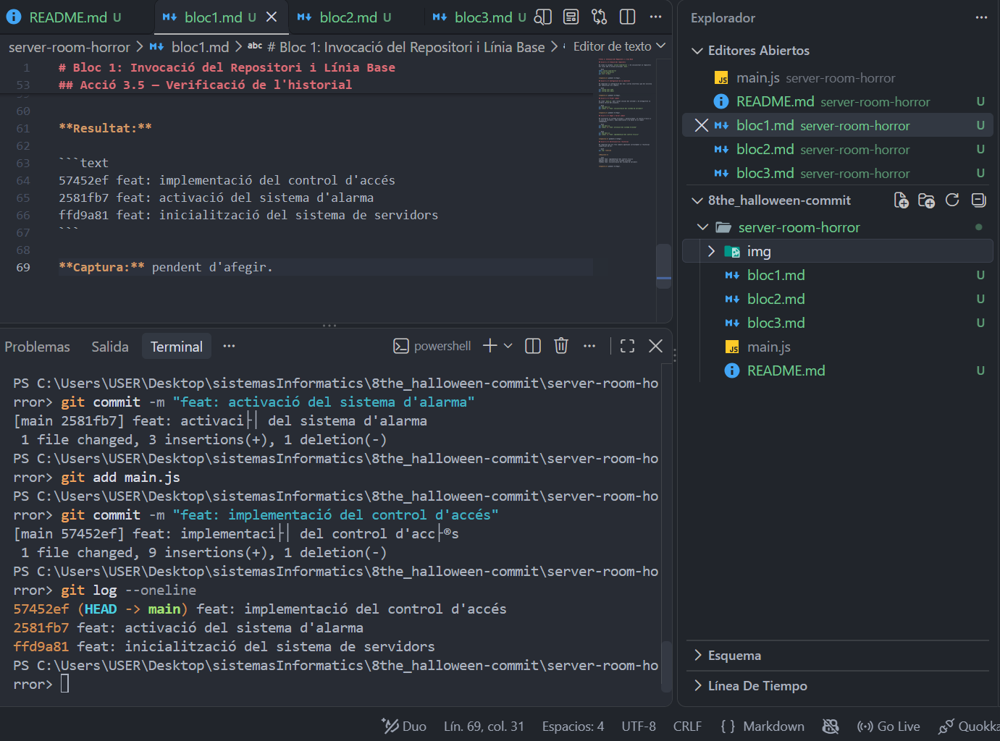
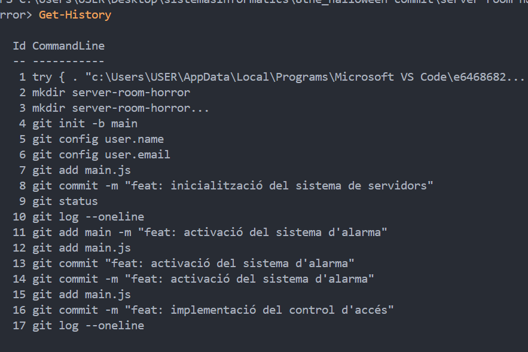

# Bloc 1: Invocació del Repositori i Línia Base

## Acció 3.1 — Creació del repositori

He creat la carpeta `server-room-horror` i he inicialitzat un repositori Git local amb la branca principal `main`.

```bash
mkdir server-room-horror
cd server-room-horror
git init -b main
```



## Acció 3.2 — Configuració de la identitat

He comprovat la configuració del nom i correu electrònic que Git utilitza per identificar els commits.

```bash
git config user.name
git config user.email
```


## Acció 3.3 — Primer commit

He creat `main.js` amb l'estat inicial del servidor i he enregistrat la primera versió del projecte.

```bash
git add main.js
git commit -m "feat: inicialització del sistema de servidors"
```



## Acció 3.4 — Segon i tercer commit

He incorporat un sistema d'alarma i, posteriorment, un control d'accés a la sala de servidors. Cada modificació s'ha desat en un commit independent.

```bash
git add main.js
git commit -m "feat: activació del sistema d'alarma"
```

```bash
git add main.js
git commit -m "feat: implementació del control d'accés"
```


## Acció 3.5 — Verificació de l'historial

He comprovat que els tres commits apareixen correctament a l'historial simplificat de Git.

```bash
git log --oneline
```

**Resultat:**

```text
57452ef feat: implementació del control d'accés
2581fb7 feat: activació del sistema d'alarma
ffd9a81 feat: inicialització del sistema de servidors
```




## Evidència addicional — Historial de comandes

He consultat l'historial de PowerShell per verificar les ordres executades durant la preparació del repositori i la creació dels tres primers commits.



```bash
Get-History