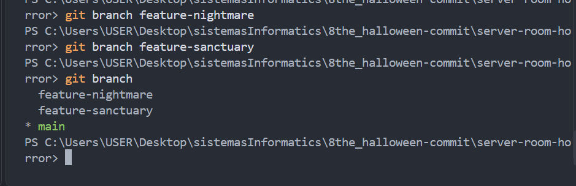
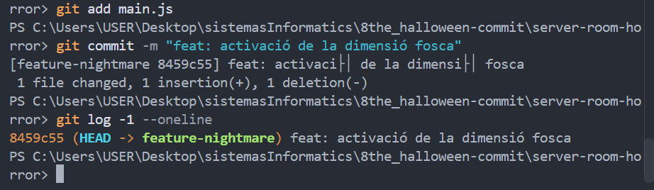
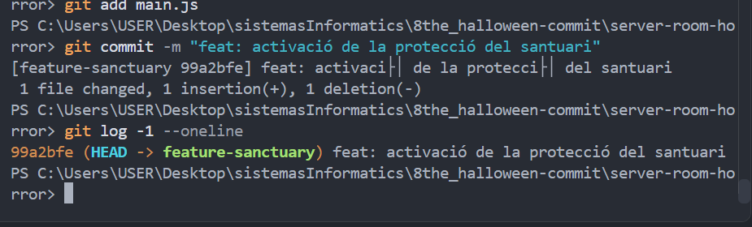
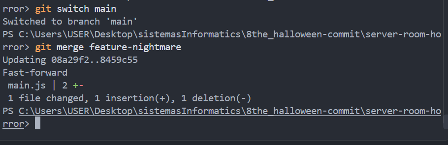
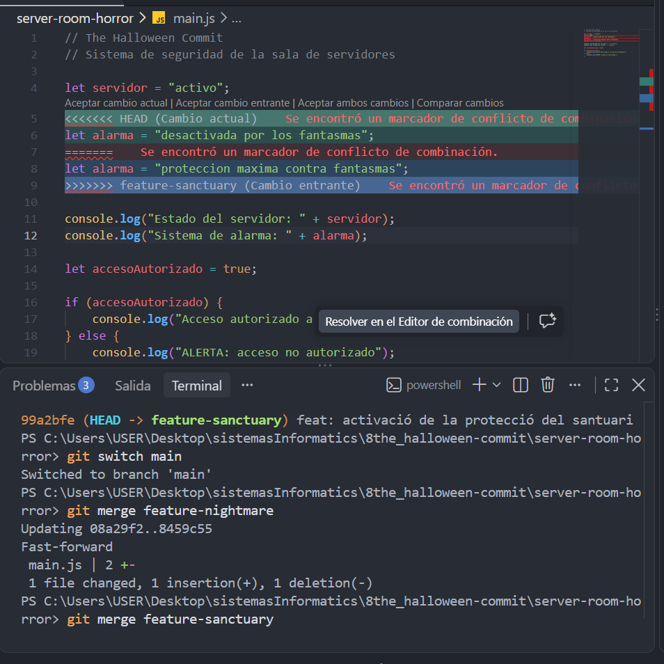
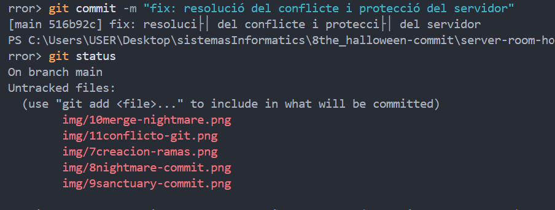
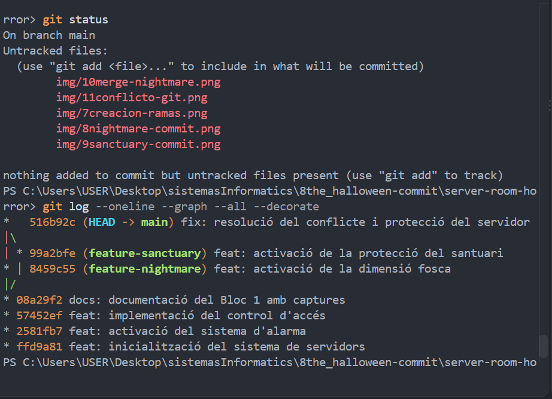

# Bloc 2: Les Branques del Més Enllà i Resolució del Conflicte

## Acció 3.6 — Creació de les branques

He creat dues branques independents a partir de `main`: `feature-nightmare` i `feature-sanctuary`.

He escollit aquesta topologia perquè les dues versions parteixin de la mateixa base estable i puguin evolucionar de manera independent.

```bash
git branch feature-nightmare
git branch feature-sanctuary
git branch
```



## Acció 3.7 — Dimensió fosca

He canviat a `feature-nightmare` i he modificat la variable `alarma` del fitxer `main.js` per simular una desactivació del sistema de seguretat.

```bash
git switch feature-nightmare
git diff
git add main.js
git commit -m "feat: activació de la dimensió fosca"
```



## Acció 3.8 — Protecció del santuari

He canviat a `feature-sanctuary` i he modificat exactament la mateixa línia de `main.js`, establint una protecció màxima contra els fantasmes.

```bash
git switch feature-sanctuary
git diff
git add main.js
git commit -m "feat: activació de la protecció del santuari"
```



## Acció 3.9 — Integració de les branques

He tornat a `main` i he fusionat primer `feature-nightmare` mitjançant un Fast-Forward.

Després he intentat fusionar `feature-sanctuary`. Git ha detectat un conflicte perquè les dues branques modificaven la mateixa línia del fitxer.

```bash
git switch main
git merge feature-nightmare
git merge feature-sanctuary
```





## Acció 3.10 — Resolució del conflicte

He analitzat les dues versions del codi i he eliminat manualment les marques de conflicte de Git.

He escollit la versió protectora del santuari per mantenir la seguretat del servidor.

El resultat final és:

```javascript
let alarma = "proteccion maxima contra fantasmas";
```

He completat la fusió amb els comandaments següents:

```bash
git diff --check
git add main.js
git commit -m "fix: resolució del conflicte i protecció del servidor"
```



## Verificació de l'historial

He comprovat la topologia de les branques i els commits de fusió.

```bash
git log --oneline --graph --all --decorate
```

