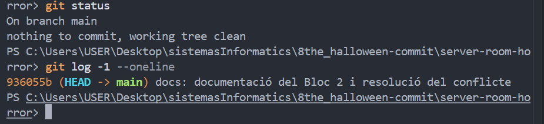
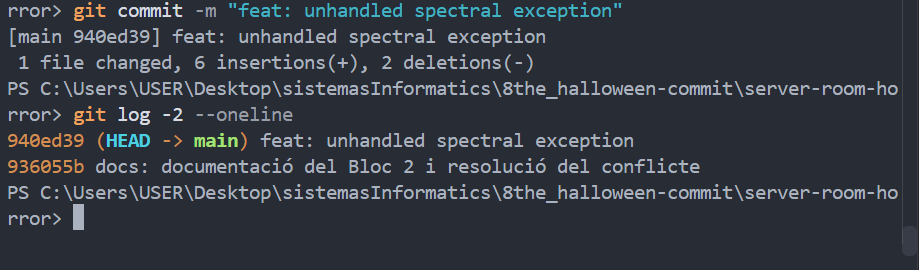
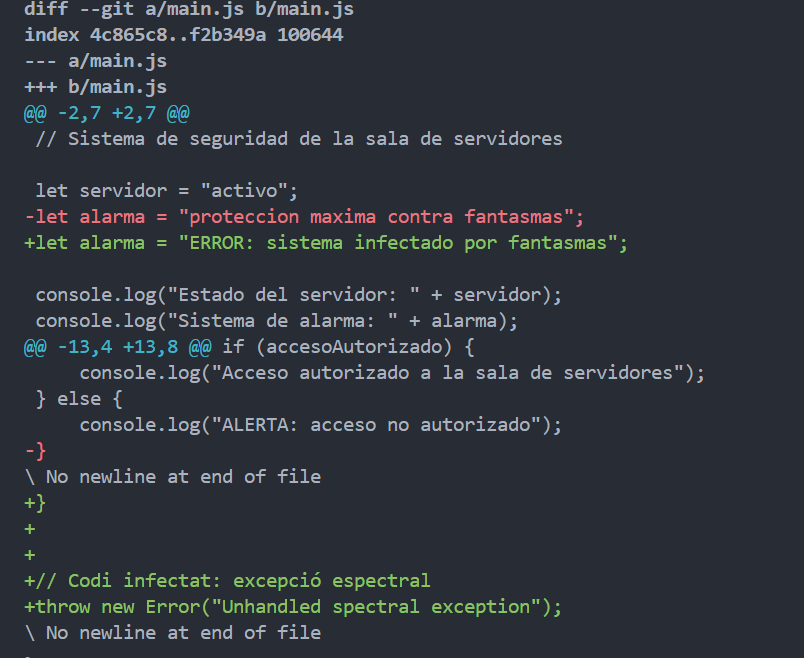
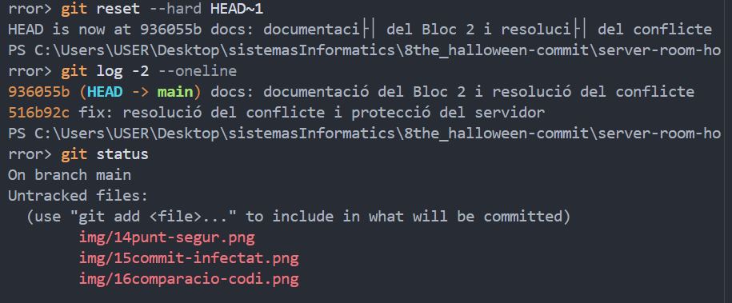
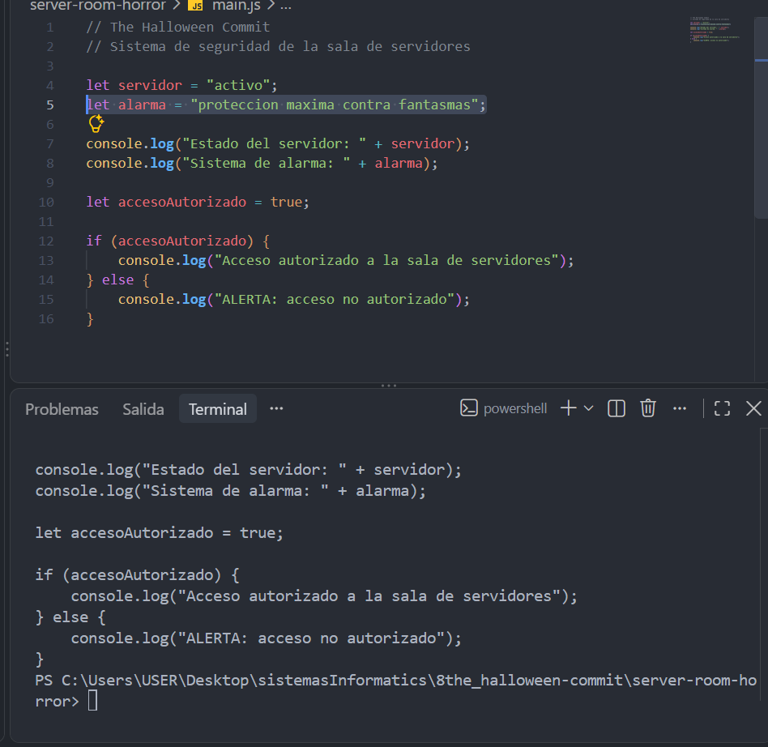
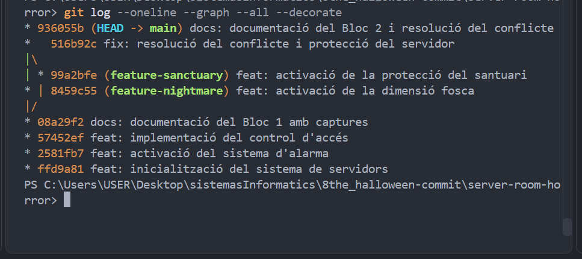
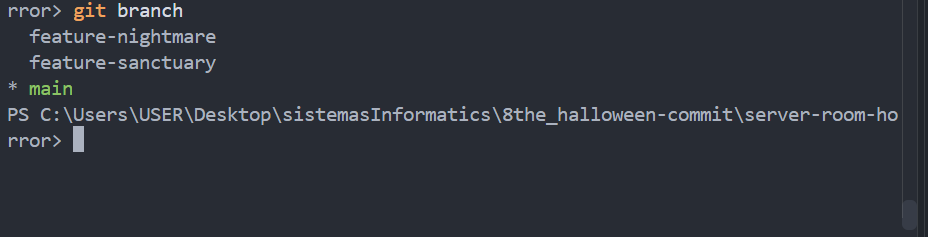
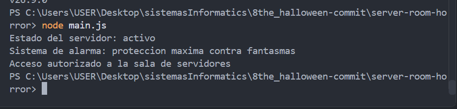
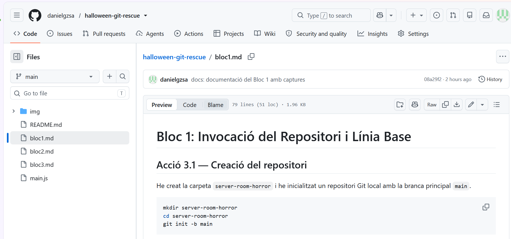

# Bloc 3: Viatge Temporal, Exorcisme del Codi i Publicació Remota

## Acció 3.11 — Creació del commit infectat

He modificat `main.js` per simular una infecció del sistema, canviant l'estat de l'alarma i afegint una excepció que interromp l'execució del programa.

He enregistrat aquest estat defectuós amb el missatge indicat a l'activitat.

```bash
git add main.js
git commit -m "feat: unhandled spectral exception"
```





## Acció 3.12 — Comparació del codi

He comparat el commit infectat amb la versió segura anterior per identificar les línies modificades.

```bash
git diff HEAD~1 HEAD -- main.js
```

Les línies vermelles indiquen el codi eliminat i les verdes mostren el codi afegit.



## Acció 3.13 — Restauració de la versió segura

He executat `git reset --hard HEAD~1` per eliminar el commit infectat de l'historial de la branca principal i restaurar els fitxers a l'estat segur anterior.

```bash
git reset --hard HEAD~1
git log -2 --oneline
git status
Get-Content main.js
```

El repositori ha tornat al commit segur `936055b`.





## Acció 3.14 — Verificació final

He comprovat la topologia del repositori i les branques conservades després de la restauració.

```bash
git log --oneline --graph --all --decorate
git branch
```





## Comprovació de l'aplicació

He executat el programa amb Node.js per verificar que el servidor funciona correctament després de la restauració.

```bash
node --version
node main.js
```

El programa mostra el servidor actiu, l'alarma protegida i l'accés autoritzat.



## Acció 3.15 — Publicació a GitHub

El repositori es publicarà a GitHub amb el nom `halloween-git-rescue`.

**URL del repositori:** https://github.com/danielgzsa/halloween-git-rescue

